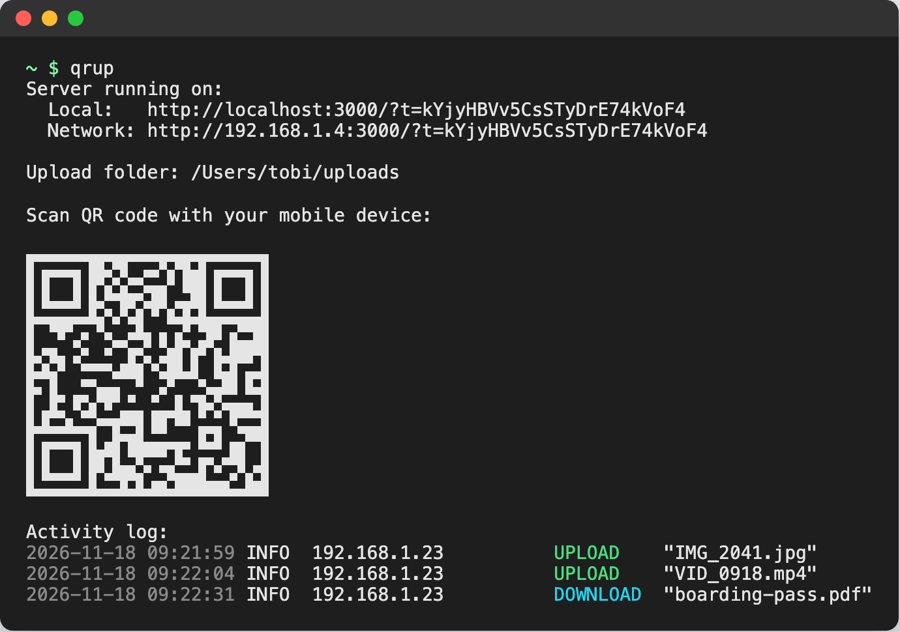
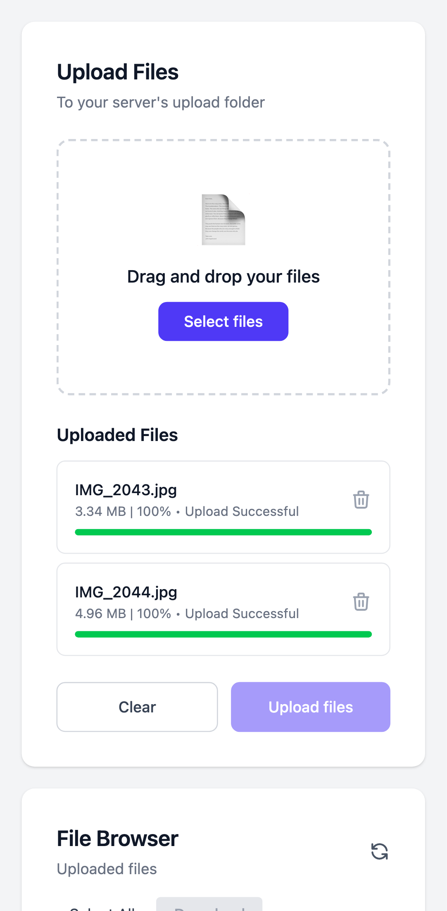
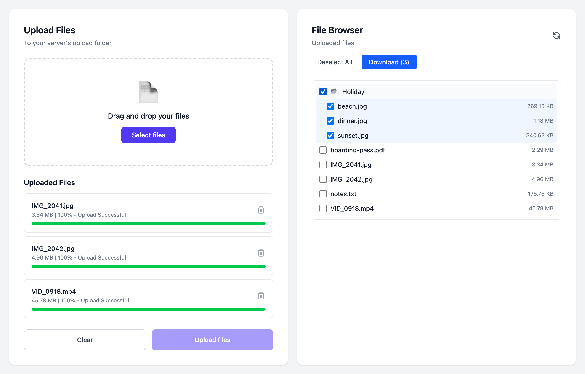

# QRUp

[](https://opensource.org/licenses/MIT)

Start qrup on your Mac or Linux machine and share files with any device on your network: phones, tablets, or other computers. Run `qrup`, scan the QR code, and use the page that opens in the device's browser. No app, no account, no cloud: files stay on your network.

Website: [qrup.me](https://qrup.me)

```bash
brew install totherush/tap/qrup
qrup
```

> 🔒 **Only devices that scan the QR code, or that you allow in the terminal, can connect.** The code contains a new access token every time qrup starts. Traffic is plain HTTP, so use qrup on networks you trust, and never expose it to the internet. See [SECURITY.md](SECURITY.md).

## How it works

1. **Start qrup** in a terminal. It prints the page's address, which includes a new access token on every start, and the same address as a QR code:

   

2. **Scan the QR code** with your phone's camera, or open the printed `Network` address (including its `?t=…` part) on any other device, such as a tablet or a Windows laptop. The upload page opens in its browser:

   

3. **Send files** either way:
   - From the device: select photos, videos, or other files. Up to three upload at a time, and each shows its progress.
   - To the device: tick files in the file browser and tap Download. Several files or a folder arrive as one ZIP.

   The same page works in a desktop browser, with drag and drop. Open the `Local` address qrup prints, including its `?t=…` part:

   

Uploads are saved to `./uploads` in the folder you start qrup from. A file whose name already exists is saved as `name (1).ext`, and a cancelled upload leaves nothing behind.

## Connect from the qrup app without the QR code

While it runs, qrup announces itself on the local network (mDNS/DNS-SD, service type `_qrup._tcp`) under the computer's name, so the qrup app lists it without scanning anything. When you pick it in the app, qrup asks in its terminal:

```text
"Pixel 9" (192.168.1.23) wants to connect. Allow? [y/N]
```

Type `y` and Enter to let the phone in; anything else denies it. The activity log records each decision as `ALLOWED`, `DENIED`, or `EXPIRED`. A request you do not answer expires after 2 minutes, and several requests are asked one after another. qrup can only ask when it runs in an interactive terminal; otherwise it denies every request. With `--open`, every request is allowed without asking.

For apps that implement the protocol: `POST /api/join` with `{ "deviceName": "…" }` answers `202 { "requestId": "…" }`. Poll `GET /api/join/<requestId>` about once a second until `status` is `approved`, `denied`, or `expired`; an approved response also contains the `token` to send as the `x-qrup-token` header. Neither endpoint needs the token. Each address has one pending request at a time, a new one replaces it, and more than 5 requests a minute are refused with 429. The service's TXT record contains `v=1`, `name=<computer name>`, and `open=1` when qrup runs with `--open`, else `open=0`. The types are in [shared/api.ts](shared/api.ts).

## Install

### Homebrew (macOS and Linux)

```bash
brew install totherush/tap/qrup
```

This installs a standalone binary for Apple Silicon, Intel, Linux x64, or Linux arm64, with nothing else to install. Update with `brew upgrade qrup`.

### Prebuilt binary

Download `qrup-<platform>.tar.gz` from the [latest release](https://github.com/totherush/qrup/releases/latest), unpack it, and run `./qrup`. Checksums are in `SHA256SUMS`.

## Usage

```bash
qrup                          # port 3000, saves to ./uploads
qrup -p 8080 -u ~/Downloads   # custom port and upload folder
qrup --help                   # all options
```

| Option                | Environment variable | Default     |                                                              |
| --------------------- | -------------------- | ----------- | ------------------------------------------------------------ |
| `-p`, `--port`        | `PORT`               | `3000`      | Port to listen on                                            |
| `-u`, `--upload`      | `UPLOAD_FOLDER`      | `./uploads` | Upload folder, absolute or relative to the current directory |
| `--open`              | `QRUP_OPEN=1`        | off         | Let anyone on the network connect, without the access token  |
| `--any-network`       | `QRUP_ANY_NETWORK=1` | off         | Also accept devices outside the local network, such as a VPN |
| `--json`              |                      | off         | Print JSON lines instead of the banner (for scripts, agents) |
| `--exit-after-upload` |                      | off         | Exit once the first batch of uploads is done                 |
| `-v`, `--version`     |                      |             | Print the version                                            |
| `-h`, `--help`        |                      |             | Print the help                                               |

qrup only serves devices on the local network: loopback, private IPv4 (`10/8`, `172.16/12`, `192.168/16`), link-local (`169.254/16`, `fe80::/10`), and IPv6 unique local addresses (`fc00::/7`). Every other address, such as a public IPv4 or IPv6 address or carrier-grade NAT (`100.64/10`, which Tailscale also uses), gets `403` and one `REFUSED` line per address in the activity log, even when your router forwards the port. To reach qrup over a VPN such as Tailscale on purpose, start it with `--any-network`; the banner then shows a warning.

### From scripts and agents

`--json` replaces the banner and QR code with one JSON object per line on stdout; prompts and warnings go to stderr. The first line says where qrup listens, then every activity log entry follows, and with `--exit-after-upload` a last line lists the saved files:

```jsonl
{"event":"listening","version":"0.2.2","port":3000,"url":"http://192.168.1.20:3000/?t=…","localUrl":"http://localhost:3000/?t=…","networkUrls":["http://192.168.1.20:3000/?t=…"],"token":"…","uploadDir":"/Users/me/uploads","open":false,"anyNetwork":false}
{"event":"activity","time":"2026-11-24T12:00:00.000Z","address":"192.168.1.5","action":"UPLOAD","subject":"IMG_0042.jpg"}
{"event":"exit","reason":"uploaded","files":["/Users/me/uploads/IMG_0042.jpg"]}
```

`url` is the first network address (`null` without one), and `token` is `null` with `--open`. `--exit-after-upload` exits with code 0 once at least one file is saved, no upload is running, and none started for 3 seconds, so all files picked at once arrive before it exits. An agent can run `qrup --json --exit-after-upload`, show the `url` to you as a link or QR code, and read the `files` of the last line after you send a photo from your phone.

The first time it runs, macOS may ask whether qrup may accept incoming network connections. Allow it, or other devices cannot reach the page.

## Development

Requires [Bun](https://bun.sh) and Node 24 (see `.nvmrc`) for the build and test tools.

```bash
bun install
bun run dev        # rebuilds the client and restarts the server on changes
bun run check      # TypeScript and Biome
bun run test:e2e   # Playwright end-to-end tests
```

See [CONTRIBUTING.md](CONTRIBUTING.md) for the project structure and how to submit changes.

### Release process

1. Run the release command on an up-to-date `main`. It type-checks, lints and builds, bumps the version in package.json, updates CHANGELOG.md, and commits and tags the release:

   ```bash
   bun run release
   ```

2. Push the commit and the tag:

   ```bash
   git push origin main --follow-tags
   ```

   The tag starts the release workflow, which compiles the binaries for macOS and Linux and attaches them and `SHA256SUMS` to the GitHub release.
   It then updates `Formula/qrup.rb` in [totherush/homebrew-tap](https://github.com/totherush/homebrew-tap) to the new version and checksums, so `brew upgrade qrup` picks it up.
